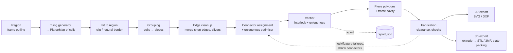

# puzzlegen — Design Document

Status: draft v0.2 (design only, no code yet; v0.2 applies the design review of
2026-11-01) · Date: 2026-11-01 · Options reference: [`USAGE.md`](USAGE.md)

A modular Python tool that generates **irregular interlocking puzzles** from planar
tilings (Voronoi, Penrose, the "hat"/Spectre monotiles, and others). It outputs
**STL/3MF** for FDM printing and **SVG/DXF** for laser or vinyl cutters. An optional
**frame** has borders that match the puzzle. The goal is a puzzle with **exactly one
valid assembly**.

---

## 1. Goals and non-goals

### Goals
| # | Goal | Measurable criterion |
|---|------|----------------------|
| G1 | Several tiling sources behind one interface | Adding a tiling = one new module, no core changes |
| G2 | Pieces interlock in the plane | For every joint (A, B) with a locking connector, B cannot slide away from A in any in-plane direction (pairwise separation test, Section 7.3) |
| G3 | Unique solution | Each connector has exactly one compatible counterpart (sufficient rule, Section 7.2). For small N, an exact solver confirms it |
| G4 | Printable or cuttable | Minimum neck width, feature size and clearance pass checks, and the STL is manifold |
| G5 | Optional frame with matching border | The frame cavity equals the union of the pieces plus clearance |
| G6 | Reproducible | Same config + seed + pinned dependency versions give byte-identical output (GEOS/Shapely versions can change float results); every run writes a JSON report |
| G7 | Controllable granularity | Target piece count N (±10 %) or target piece size |

### Non-goals (for v1)
- True 3D puzzles (burr or volumetric interlocking). The tool makes 2.5D pieces: 2D
  outlines extruded to a thickness.
- Image printing on pieces. A later hook for multi-colour top layers is planned (Section 10.5).
- A GUI. The tool is CLI + config file; it writes an SVG preview.

---

## 2. Core idea: a pipeline over a planar map

The key design decision is to keep **topology (shared edges) as the primary data
structure, not individual polygons**. Each interior edge between two pieces exists
once, is decorated once (with its connector curve) and is consumed by both neighbours
in opposite directions. This guarantees gap-free, overlap-free pieces by construction.
Clearance is applied only at the very end, as a fabrication step.



Every stage is a pure function `PlanarMap → PlanarMap` (or `→ Pieces`) with explicit
parameters and an explicit `numpy.random.Generator`. This makes stages
unit-testable, swappable and reproducible.

### 2.0 Terms
| Term | Meaning |
|------|---------|
| **cell** | One tile produced by a tiling generator |
| **piece** | A face after grouping: one or more cells; one printed part |
| **edge** | One undirected edge of the planar map (between two vertices) |
| **joint** | The maximal chain of edges shared by two specific pieces (or a piece and the frame). A pair of pieces can share more than one joint |
| **connector** | The decoration on a joint: a head (protrusion) on one side and the matching socket on the other |
| **boundary joint** | A joint between a piece and the frame or outside |

### 2.1 Central data structure: `PlanarMap` (half-edge / DCEL)

```
Vertex   : id, pos (x, y)
HalfEdge : id, origin → Vertex, twin, next, prev, face, curve_id
Face     : id, outer half-edge, kind ∈ {cell, piece, outside, frame}, ancestry, tags
           (ancestry = tuple of supertile ids per substitution level; empty for Voronoi)
Curve    : id, polyline (vertex→vertex in canonical direction), connector spec, edge_class
```

- A **cell** is a tile from the generator. A **piece** is a face after grouping (one
  or more cells merged). Grouping removes internal edges and keeps a
  `piece → [cells]` mapping for reporting.
- A `Curve` belongs to one *undirected* edge. Each half-edge reads it forwards or
  backwards. Connector decoration replaces the straight segment with a polyline, and
  both faces change consistently.
- Vertex deduplication: generators that produce floating-point coordinates build the
  map through a snapping hash (round to 1e-7 mm). Substitution tilings can instead use
  exact coordinates (Section 4.3).
- Implementation: plain Python dataclasses with numpy arrays for positions.
  Shapely 2 is used for geometry operations (clipping, buffering, validity) but **not**
  as the source of truth for adjacency.

Why not polygons only? With independent polygons, shared edges drift apart after
decoration or offsetting, gaps and slivers appear, and adjacency has to be
reconstructed with tolerance. That is fragile, so polygons are avoided as the primary
store.

---

## 3. Region and frame (input shape)

A `Region` is a Shapely polygon: a rectangle, ellipse/circle, regular polygon, or the
largest closed outline of an SVG file (M4, via `svgelements`; may be non-convex, holes
are ignored). A relative `region.path` is resolved against the config file's folder.
Non-convex regions can split a clipped cell into several parts; each part becomes its
own cell.

**Border modes** (implemented in M4, `border.py`):

| Mode | How it works | Frame cavity |
|------|--------------|--------------|
| `clip` | Tiling clipped to the outline; slivers are merged by cleanup (§6.3) | Smooth outline (+ clearance/2) |
| `natural` | Tiling generated over the outline grown by `region.margin`; after grouping, whole pieces whose centroid lies inside are kept. Enclosed pieces are added and only the largest connected part is kept, so the region stays one polygon without holes | Jagged outline of the pieces |
| `natural+clip` | Same pieces as `natural`; use `frame.exterior = "bbox"` for a rectangular outside | Jagged |

**Frame** (`frame.style`):
- `tray` (base plate + wall), `ring` (wall only) or `none`.
- Cavity = outline of the *un-offset* piece union, grown by `+clearance/2`. Pieces
  shrink by `clearance/2` (§8), so the gap to the frame equals the gap between pieces.
  Exterior = bounding box (rounded corners) or offset of the cavity, plus the wall
  width.
- Thin frame spikes reaching into narrow notches between border pieces (natural
  borders) are removed by an opening of `min_feature`/2; a small void remains instead.
- **Frame connectors** (`frame.connectors`, auto = on for natural borders), M4:
  boundary joints get tabs like interior joints. A head pointing into the frame must
  stay inside the frame wall with `min_wall` to its outer edge and to every other
  piece; a head from the frame into a piece follows the normal socket rules. The frame
  acts as a fixed piece (face 0) in the uniqueness check, the mate graph and the lock
  check (a lock with the frame holds its edge piece), and the cavity follows the
  pieces' union including these connectors.
- Large frames are split into segments that fit the print bed, joined by dovetails
  (`frame.max_segment`). A thumb notch helps lift the first piece.

---

## 4. Tiling generators (plugins)

Interface:

```python
class TilingGenerator(Protocol):
    name: str
    def generate(self, region: Region, target_count: int,
                 rng: np.random.Generator, **params) -> PlanarMap: ...
```

Generators register via a simple registry dict (no plugin framework). Each generator
must return a map that covers `region.buffer(margin)`.

### 4.1 Voronoi (first implementation, simplest and most flexible)
- **Seeds**: blue noise for even piece sizes (Mitchell's best-candidate sampling: it
  yields exactly N points, whereas Bridson's Poisson-disk method fixes a radius and the
  count varies), or uniform random for a chaotic look. Density can be modulated by a grey-scale image or a function, so
  piece size varies across the puzzle (a difficulty gradient).
- **Lloyd relaxation**, 0–k iterations: a regularity knob that runs from chaotic to
  honeycomb-like.
- **Power (weighted) diagram**: optional, for controlled size variance.
- Library: `scipy.spatial.Voronoi` on seeds plus mirrored ghost seeds, then clipped
  to the region.
- Voronoi cells are convex, so they **never interlock by shape alone** and connectors
  are required (Section 5). Degree-3 vertices are typical, which is good for
  connector placement.

### 4.2 Penrose (P3 rhombus; P2 kite/dart deferred) via Robinson-triangle substitution
Implemented in M3 (`tilings/penrose.py`).
- Start from a "sun" of 10 acute Robinson triangles and apply **deflation** k times;
  each step scales tiles down by φ. An acute (red) triangle splits into 1 acute +
  1 obtuse, an obtuse (blue) one into 2 obtuse + 1 acute (Preshing's rules). Two
  triangles sharing edge BC form a rhombus. Half-triangles without a partner lie at
  the patch border, outside the region.
- **The rules are verified geometrically, not trusted** (`tests/test_penrose.py`):
  total area is conserved, every BC pair is a thick (72°/108°) or thin (36°/144°)
  rhombus with equal sides, and the thick:thin ratio approaches φ.
- **P2 (kite/dart) is deferred to M6.** A rule set derived from the half-kite/half-dart
  geometry (32 orientation variants searched) produced kites and darts locally, but
  left pairing defects inside the patch, not only at its border. So it is not a valid
  Penrose tiling and was not shipped.
- **Granularity**: the level is the first whose rhombi inside the region reach the
  target count. Then the whole patch is scaled *up* by √(count/target), which keeps
  it covering the region and brings the count to about the target (levels alone jump
  by φ² ≈ 2.6×).
- The sun's centre is shifted and rotated randomly (seeded), because the sun is
  5-fold symmetric and identical seeds would repeat whole patches.
- **Hierarchy**: for `grouping.strategy = "hierarchy"` the target count applies to the
  piece level, cells are `grouping.level` (default 2) levels finer, and each cell is
  tagged with its piece-level rhombus. Depth 3 gave outlines too fine for connectors
  and many loose pieces.
- Rhombi have only two shapes and all joints the same length, so the connector
  alphabet is stretched: the repair loop's drop step (§7.4) and the rescue pass for
  pieces without a lock were added for Penrose.

### 4.3 Hat and Spectre (aperiodic monotiles)
- **Hat**: a 13-gon (or a 14-gon with two collinear edges) made of 8 kites of the
  [3.4.6.4] Laves tiling, from Smith, Myers, Kaplan and Goodman-Strauss (2023). It
  belongs to the continuum `Tile(a,b)`: hat = Tile(1, √3), turtle = Tile(√3, 1).
  Tile(0,1) (chevron) and Tile(1,0) (comet) tile periodically. Hat tilings contain
  **reflected** hats.
- **Spectre**: Tile(1,1) with modified (curved) edges. It is *strictly chiral*: it
  tiles aperiodically with no reflected copies, even when reflections are allowed.
  So **all Spectre pieces have the same handedness**.

**Implementation (M4)**:
- The substitution systems are **vendored, not re-derived**
  (`tilings/_kaplan.py`): Kaplan's hatviz (BSD-3) via the hat-amp port (MIT), and
  Kaplan's Spectre app via hat-amp (the Spectre app's own licence could not be
  verified; see `THIRD_PARTY_NOTICES.md`).
- They are **verified geometrically in tests**: every tile is congruent to the
  prototile, tiles do not overlap, hat patches contain reflected hats (about 12.7 %),
  and Spectre patches have one handedness only.
- That verification found a flaw in the source: Kaplan's *intermediate* hat patch
  holds scaffolding tiles that overlap real ones and belong to no extracted metatile,
  yet hat-amp's patch-level API returns them. The tool expands the H metatile instead,
  as hatviz itself draws it.
- **Placement**: the tile size follows from the target count (for grouped strategies,
  times the mean group size). The substitution level grows until the region, rotated
  randomly (seeded) and scaled, fits inside the patch shrunk by two tile diameters,
  anchored at the patch's deepest interior point.
- **Tags**: the tree path cut to `height` levels above the tiles. `metatile` = height 1
  (H/T/P/F clusters of 4, 1, 2, 2 hats); `hierarchy` = `grouping.level` (default 2).
  Spectre tiles inside a Mystic sit one level deeper; cutting by absolute prefix length
  keeps both halves together.
- The hat's length-2 edge produces T-junctions with neighbouring vertices;
  `PlanarMap.from_polygons` inserts such vertices into the edges.
- **Not yet** (M6): other `Tile(a,b)` members (turtle etc.) and the Spectre's curved
  edges; both need their own geometry.
- **Observed in M4**: one hat per piece at about 30 pieces gives many joint-level
  pairs, because identical hat outlines repeat. Yet the exact solver proves one
  assembly (§7). Metatile grouping with hybrid connectors also passes.

### 4.4 Additional cheap generators (later)
- Jittered square or hex grids: the classic jigsaw baseline, useful for tests.
- Archimedean or Laves tilings, plus random edge flips.
- Imported SVG/DXF line art (user-drawn cells) → `PlanarMap` via polygonize.
- Centroidal Voronoi on an image (stippling-like): piece density follows image
  contrast.

---

## 5. Connectors (edge decorations)

A connector is a parametric curve that replaces the straight chord between an edge's
two endpoints. Its *position* is given in a normalised edge frame (x along the chord
from 0 to 1, y normal to it). Its *shape* (head, neck) is in absolute mm, because
physical fit depends on absolute size, not on the chord length L.

```python
@dataclass(frozen=True)
class ConnectorSpec:
    kind: str          # "tab", "dovetail", "tee", "wave", "none", ...
    side: int          # +1 bulges into the left face, -1 into the right face
    t: float           # position along the edge (0.3..0.7)
    size: float        # head size in mm (absolute; clipped to the feasibility zone)
    params: tuple      # kind-specific shape parameters (neck ratio, skew, asymmetry...)
```

### 5.1 Connector library
| Kind | Shape | Locking | Notes |
|------|-------|---------|-------|
| `tab` | Classic jigsaw knob: Bézier neck plus round head | Yes (neck < head) | Default. Parametrised by neck width, head radius, skew, asymmetry and wobble |
| `dovetail` | Trapezoid | Yes | Good for laser-cut wood; also used for frame segments |
| `tee` / `hook` | T or L shapes | Yes | High uniqueness entropy |
| `swirl` | S-curve along the whole joint, two hooking lobes | Yes (sweep ≥ 180° + margin) | Connector-free look; see §5.4 |
| `wave` | Sine or spline wiggle with no neck | **No** | Decoration only. Pair with locking edges |
| `double` | Two small tabs, opposite sides | Yes, strong | For long edges |
| `none` | Straight | No | Short edges, or frame edges if desired |

### 5.2 Geometric feasibility (per edge)
- A connector's swept region must stay inside the **feasibility zone** of the edge:
  the intersection of both adjacent faces, shrunk by `min_wall`, and kept away from
  the edge's end vertices by `end_margin`. Compute this zone with Shapely (a lens
  shape built from the two faces). The head size is clipped to it.
- Connectors on edges that share a face must not collide. Check pairwise intersection
  of their swept regions per face. On conflict: reduce size, shift `t`, or flip `side`.
- `end_margin` keeps every socket strictly inside one piece, so no head can be
  received by a pocket made by two pieces near a vertex (Rule U3, Section 7.2).
- **Short joints** (L < `min_edge`, about 2.5 × head diameter) cannot
  carry a lock. Edge cleanup (Section 6.3) should eliminate them. Any that remain are
  flagged in the report.

### 5.3 Fabrication constraints that drive connector sizing (FDM, 0.4 mm nozzle)
| Parameter | Default | Rationale |
|-----------|---------|-----------|
| `clearance` (total gap) | 0.20–0.30 mm | Typical FDM fit; tune with a test-coupon command |
| `min_neck` | ≥ 3 mm (≥ 7 lines of 0.4 mm after offset) | Necks break first |
| `min_feature` | ≥ 1.6 mm | Two perimeters per side with a 0.4 mm nozzle |
| `min_radius` (concave) | ≥ clearance + 0.4 mm | The nozzle cannot reproduce sharp inner corners |
| `thickness` | 3–5 mm | Stiffness vs print time |
| Laser `kerf` | 0.1–0.2 mm (material dependent) | Here clearance = kerf; edges are cut once (Section 9.1) |

These defaults are engineering starting points, not measured values. Section 11 adds a
calibration coupon generator to measure them per printer and material.

### 5.4 Shape-locked (connector-free) puzzles
Goal: pieces that hold together by their outline alone, with no visible knobs. The
outline itself has to interlock.

**Lock criterion** (implemented in `interlock.py`). Consider one joint between pieces A
and B on its own. B can slide away from A in direction d exactly when the joint curve
is a graph over the axis perpendicular to d. That holds when every line parallel to d
crosses the curve at most once, which is the case when all tangent directions of the
curve lie in an open half-plane. Hence:

> A joint **locks** iff its unwrapped tangent angle sweeps at least 180°.

If any line parallel to d crosses the curve twice, B is blocked in both +d and −d. So
a sweep of at least 180° blocks every direction. A margin is added
(`connectors.lock_margin`, default 20°), so that the overhang survives the clearance
gap. Examples:

| Joint shape | Sweep | Locks? |
|-------------|-------|--------|
| Straight edge, or any convex polygon edge | 0° | no |
| Semicircular bump (no undercut) | 180° | no (limit case) |
| Keyhole tab | ≈ 290° | yes |
| Swirl (below), lobes of 110° each | 220° | yes |

Consequence: tiles bounded by straight edges (Voronoi, Penrose, hats) never lock
across a single edge. Shape-lock needs either curved joints or grouped outlines.

**Three ways to get shape-lock:**

1. **Swirl joints** (`connectors.kinds = ["swirl"]`, implemented in M2). Most of the
   joint is replaced by a smooth S-curve with hooking lobes, one into each piece. The
   result looks organic, Escher-like, with no distinct knob.
   Construction: prescribe the turning function θ(u) = θₖ · sin 3πu over a window of
   the joint, with separate amplitudes θ₁, θ₂, θ₃ for the three thirds. The curve
   rises (crest into one piece), crosses the chord in the middle, and returns (trough
   into the other piece). Integrate the unit tangent, then rotate and scale so the
   curve ends exactly on the chord. Sweep = max(θ₁, θ₃) + θ₂; sampling enforces at
   least 180° + `lock_margin` + 5°.
   A first version with θ · sin 2πu turned out to rise and fall on the same side: one
   mushroom-shaped bump, not an S.
   Feasibility: the curve keeps `min_wall` to both faces' other boundaries. Both
   faces must survive erosion by (min_neck + clearance)/2 without splitting, *and* an
   opening by the same radius must not remove material along the middle of the
   swirl. A lobe with a thin throat vanishes under erosion instead of splitting; this
   was found when the corner rounding cut such lobes off.
   **Size limit (measured):** throats reach 3.25 mm only for windows ≥ 16–20 mm. Swirls
   therefore need joints of about 22 mm or more: use `connectors.min_edge = 22` and
   larger pieces (about 20 pieces on 180 × 130 mm). Windows are never shrunk on
   retry, because shrinking only narrows the throats.
   Uniqueness: the signature is the window curve. The three amplitudes and the
   window length give a richer alphabet than single tabs. In M2 tests, 20–24-piece
   swirl puzzles reached a unique exact-solver result.
2. **Grouped outlines** (`grouping = grow | hierarchy | metatile`, with
   `connectors.kinds = ["none"]`). Pieces are unions of many small cells (fine hex or
   triangle grids, Voronoi, Penrose rhombi, hats). Their jagged boundaries overhang
   where a neighbour's cells reach around a corner.
   Locking is not automatic, so the `grow` strategy gets a **lock objective**: when a
   piece chooses its next cell, it prefers cells that create an overhang into a
   neighbour (the joint sweep increases), and it rejects groupings that leave a piece
   without any locked joint.
   For `hierarchy`/`metatile`, candidate supertile levels are scored by their locked
   fraction, and the best level is chosen.
3. **Hybrid**: shape-lock where it happens, and tabs only on joints that do not lock by
   shape (`connectors.placement = "unlocked"`, planned for M3). This keeps knobs rare.

**Requirement for every mode:** each piece needs at least one locked joint. Pieces
without one are reported as `interlock.loose_pieces`. With
`connectors.require_lock = true` they are a failed check (exit code 2).

**Limits**:
- The criterion tests each joint on its own. Two non-locking joints between the same
  pair of pieces can lock together; the sampled translation test of §7.3 covers that
  case.
- The angle margin only approximates "the overhang is deep enough". A later refinement
  measures the overhang depth directly and requires at least k × clearance.

---

## 6. Grouping and cleanup (granularity and interlock from tiling structure)

### 6.1 Why grouping
- The tiling granularity is not always the piece granularity. Substitution tilings
  jump in coarse steps, and N is rarely hit exactly.
- Grouping is the main source of **shape irregularity**. It is also the only way to
  get *shape-based* interlock from convex or polygonal tilings.

### 6.2 Grouping strategies (`grouping.py`, M3)
| Strategy | Description | Best with |
|----------|-------------|-----------|
| `identity` | 1 cell = 1 piece | Voronoi, grids, Penrose with connectors |
| `hierarchy` | Piece = all cells under one supertile (`grouping.level` levels coarser) | Penrose (hat/Spectre in M4) |
| `grow` | Seeded region growing on the cell adjacency graph, then a lock-objective local search | Any. Fine cells → polyform-like pieces |
| `metatile` | Hat-specific: H/T/P/F clusters as pieces | Hat (M4) |

- **Merging cells into a piece**: edge cancellation on vertex rings. Shared edges
  cancel, and the rest must be *one* simple cycle (no pinch vertex, no hole).
  Shapely unions are not used, because they may drop vertices that neighbours still use.
- **grow**: seeds are placed by farthest-point sampling; the smallest piece grows
  next. A candidate cell is scored by compactness (distance to the piece centroid)
  blended with randomness (1 − compactness). A cell is only added if the piece stays
  one simple polygon **without a neck below `min_neck`**: cells joined by a short
  shared edge made thin necks in the first version.
- **Lock objective**: a local search after growth. For each neighbouring pair whose
  joint does not lock (turning criterion, §5.4), a boundary cell moves across if
  that raises the joint's sweep, keeps both pieces valid and within 0.5–1.8 × target
  size, and does not reduce the two pieces' locked joints. Pieces without any lock
  are processed first. Typical result: about half of all joints lock by shape alone.
- **Small pieces** (region-clipped supertiles, leftover cells) are merged into the
  neighbour with the longest shared boundary.
- Bent joints between pieces become **chain curves** (`PlanarMap.from_rings_chained`).
  A chain without a connector gets a `shape` profile, so the uniqueness check covers
  it (whole outline as signature).
- **Hybrid (`connectors.placement = "unlocked"`)**: joints that lock by shape keep
  their outline. Others get a tab on their longest segment, or, if the segments are
  too short (≈ 6 mm between small cells), the chain is replaced by its straight chord
  and a tab or swirl goes there. A non-locking chain loses nothing by straightening.
  Ambiguous pairs of shape joints are resolved the same way in the repair loop.

Shape-locked joints fall outside the signature rule U2 (§7.2); for them the whole
joint profile is the signature. Hierarchical tilings repeat local patches, so profiles
recur: in shape-locked modes uniqueness is *checked*, not constructed. Measured in M3
(30 pieces): pure-shape Voronoi `grow` reached `strict`, while hex `grow` and Penrose
hierarchy kept 1–3 ambiguous pairs. The hybrid mode resolves most of these.

### 6.3 Edge cleanup
Implemented in `cleanup.py` (M2), operating on vertex-index rings before connectors
are placed:
1. **Sliver removal**: pieces with area < `min_area_ratio` × median area, or thinner
   than `min_feature` + clearance, are merged into the neighbour with the longest
   shared boundary, smallest first. Rings are merged directly, not with Shapely
   unions, because a union may drop a vertex that a third piece still uses.
2. **Straightening**: interior vertices used by only two pieces (left over after
   merges) are removed, so each joint is one straight edge again.
3. **Short-joint contraction**: interior joints shorter than `connectors.min_edge`
   (or `cleanup.collapse_edge` when no connectors are used) are contracted to one
   point, shortest first. The two pieces then touch only at a corner where four
   pieces meet, as in classic jigsaws. A contraction that would break a face is
   skipped; boundary vertices never leave the outline. On the 40-piece Voronoi
   example this turned 28 tab-less joints out of 96 into 0 out of 75.
4. **Chain joints** (M3): bent joints keep their vertices inside one chain curve
   (`PlanarMap.from_rings_chained`); only vertices bending less than
   `collinear_angle` are straightened. Removing bent vertices moved whole triangles
   of area between pieces (seen on merged Penrose fragments).
5. **Degree-4+ vertex splitting** (`split_degree4`, M6, for grids and Penrose).
   Contraction creates degree-4 vertices on purpose, so splitting applies only to
   tilings that have them natively.

---

## 7. Uniqueness (the core quality property)

### 7.1 Definitions
- An **assembly** places each piece (rotation ∈ SO(2), plus a reflection if pieces
  are flippable) inside the frame cavity with no overlap and full coverage.
- **Unique** means that exactly one assembly exists, up to nothing (the frame fixes
  the global pose). Without a frame, it is unique up to a global rigid motion.

### 7.2 Sufficient conditions and the two guarantee levels
Exact-cover uniqueness for arbitrary shapes is NP-hard in general, so the tool checks
sufficient conditions.

> **Rule U1 (locked joints):** every interior joint carries a locking connector.
> Joints too short for one are removed by cleanup (§6.3).
>
> **Rule U2 (unique heads):** a head fits no socket in the puzzle other than its true
> partner (Hausdorff distance ≥ τ, under rotation and, if flippable, reflection).
> Heads and sockets are compared **locally**, in absolute mm.
>
> **Rule U3 (no composite sockets):** no head can be received by a pocket formed by
> two pieces. This is enforced by `end_margin`: every socket lies inside one piece.

Argument: in any valid assembly every head sits in some socket (the area is filled
exactly). By U3 that socket belongs to one piece, and by U2 it is the true partner.
Each mate fixes a relative pose, and the mate graph is connected (checked), so every
pose is forced.

**Capacity limit (measured in M2).** At τ = 0.75 mm, random greedy packing found only
about 10 distinguishable tab shapes with the M1 parameter ranges, about 60 with the
widened M2 ranges (tilt ± 25°, neck height 0.3–0.9 r, head 5–8 mm), and about 130
with heads of 4–10 mm (about 75 if flippable). A 40-piece puzzle has about 75 joints.
Strict U2 is therefore only reachable for small puzzles. The earlier estimate of
1500–2300 signatures was wrong.

So two levels are reported (`checks.uniqueness.guarantee`):

| Level | Condition | Meaning |
|-------|-----------|---------|
| `exact` | The exact solver (≤ 30 pieces) ran to completion and found exactly one assembly | Proven for all assemblies reachable through mates (with a frame: starting from the fixed frame). Overrides the levels below when available (M4) |
| `strict` | U2 holds for every connector | Unique by the argument above (with U1, U3 and a connected mate graph) |
| `joint-level` | No shape-compatible pair whose joints also end at the same two points when mated | A false mate would need the rest of the joint bordered by other pieces meeting it mid-edge (T-junctions), and that would have to continue consistently through the whole puzzle. Not excluded in principle, but very contrived |

`ok` requires no joint-level ambiguity, a connected mate graph, and (when it runs)
at most one solution from the exact solver.

Rejected: **pose exclusion.** The idea was to place A so that its head sits in B's
socket and reject the mate if A overlaps B or leaves the region. Convex pieces never
overlap across a straight joint, and in an alternative assembly B itself may sit
elsewhere, so the region test is invalid. In M2 tests it excluded nothing.

Tolerance τ = `tolerance_k` × clearance (default 3 × 0.25 = 0.75 mm). Connectors that
differ by less count as interchangeable. This is conservative, because people force
near-fits.

### 7.3 Signature and verifier (`uniqueness.py`)
- **Profile**: one side of a decorated joint, seen from that piece. Origin at the
  connector's base midpoint, x along the piece's counter-clockwise direction, y along
  its outward normal (a head has y > 0). Two profiles a and b can mate iff a ≈ −b; the
  true partner gives exactly −a. A KD-tree on bounding-box features pre-filters the
  pairs; the exact test is the Hausdorff distance.
- **Joint-level test**: for a shape-compatible pair, check whether both joints'
  endpoints coincide when mated (within τ).
- **Mate graph**: pieces linked by decorated joints; it must have one component.
- **Interlock (pairwise separation) test**: decided analytically per joint by the
  turning criterion (§5.4). A sampled translation test for pairs of pieces that share
  several joints follows in M3.
- **Exact solver** (`uniqueness.exact_solver`, auto for ≤ 30 pieces): depth-first
  placement through shape-compatible mates, counting overlap-free assemblies inside
  the region up to 2, with a 20 000-node budget. This includes T-junction placements.
  It only explores assemblies whose pieces attach to the first piece through mates.

### 7.4 Optimiser (`connectors/__init__.py`, `pipeline.py`)
1. Joints are processed shortest first (fewest feasible shapes).
2. For each joint, 8 random candidates (tab and/or swirl) are drawn and ranked by
   distance to the most similar connector already placed (capped at τ): first among
   connectors whose joints would also end at the same points when mated (the
   joint-level criterion), then among all. The first feasible candidate is taken.
   Ranking by the joint-level criterion first fixed most grid failures in the M2
   stress test, because grids have many joints of nearly equal length.
3. Repair loop: one connector of each **joint-level** ambiguous pair is re-drawn,
   followed by a new verification. This stops after 10 rounds or `max_iter` re-draws.
   Shape-only pairs are not chased: beyond the alphabet's capacity re-drawing cannot
   remove them (measured: 85 pairs left after 2000 re-draws on 75 joints, taking 70 s).
4. If joint-level ambiguities remain, the uniqueness check fails (exit code 2).

To reach `strict` on larger puzzles: widen `connectors.head_size`, mix `tab` and
`swirl`, or use fewer pieces. Compound connectors (two heads per joint, M6) would
square the alphabet.

### 7.5 Flip prevention (single-sided printing)
Printed pieces are two-sided, so reflection doubles the ambiguity. Options (combinable):
- Make all signatures reflection-distinct: the verifier compares the reflected
  orientation too, and asymmetric `skew` parameters are used. This is the default.
- Add a top-edge chamfer or fillet only on the top face: this gives a visual and
  tactile cue.
- Print a two-colour top layer or image (Section 10.5).
- Spectre tilings are chiral, so flipped pieces are never needed by the tiling itself.

---

## 8. Piece geometry construction
1. For each piece face, walk its half-edges and concatenate the curve polylines
   (reversed where needed) to get a closed outline. Validate with `shapely.is_valid`.
2. **Clearance**: apply `buffer(-clearance/2, join_style="round")` to each piece and
   `buffer(+clearance/2)` to the frame cavity, so the total gap is `clearance`. Round
   joins give automatic concave fillets.
3. **Post-offset checks**: recompute the minimum neck width (inscribed-circle width
   along the medial axis, approximated by negative buffer of `min_neck/2`; the piece
   must stay connected), the minimum feature size, and validity. Failures are fed
   back to the optimiser (Section 7.4) as size reductions.
4. **Optional rounding**: a small positive-then-negative buffer smooths corner tips
   (convex radius).

---

## 9. Output

### 9.1 2D (laser, plotter, vinyl cutter)
- **SVG** (and **DXF** via `ezdxf`), with layers: `cut` (piece outlines), `frame`,
  `engrave` (IDs or artwork), `preview` (filled, coloured pieces).
- **Shared-edge cutting**: a laser cuts each joint *once* (one path per `Curve`, not
  per piece), which halves cut time and makes kerf the natural gap. In this mode
  clearance is not applied, and kerf compensation is optional.
- Path ordering: greedy nearest-neighbour ordering to cut travel time. Long joint
  chains are cut continuously.

### 9.2 3D (FDM)
- **Extrusion**: polygon → mesh via `manifold3d` (guaranteed-manifold booleans and
  extrusion), and file I/O via `trimesh` (STL, 3MF).
- **Optional features per piece**: top chamfer or fillet (`top_edge = chamfer:0.4`), a
  bottom chamfer of about 0.3 mm against elephant foot, and an engraved piece ID on
  the bottom (needed for unique-solution debugging; switchable off for difficulty).
- **Frame**: the tray (base plate + wall) is a boolean of exterior minus cavity, plus
  floor. Splitting it uses dovetails.
- **Plate packing**: pack the pieces' oriented bounding boxes (or true outlines with a
  simple bottom-left fill) onto `bed_size` plates with spacing `plate_gap`. Output is
  one STL or 3MF per plate, plus single-piece files on demand.
- **Mesh checks**: manifold, watertight, volume > 0, minimum wall thickness.

### 9.3 Report (`<name>_report.json`)
Every check result goes into the report, never only to stdout. It contains the
config, seed, version, piece count, area stats, joint count, connector-kind
histogram, min neck/feature found, ambiguous pairs (should be 0), floating pieces,
per-piece cell ids and ancestry (for hierarchical tilings), and plate assignment.

---

## 10. Software architecture

### 10.1 Package layout
```
puzzlegen/
  pyproject.toml
  src/puzzlegen/
    __init__.py
    cli.py              # argparse; subcommands: generate, verify, coupon, preview
    config.py           # dataclass config + TOML loading (tomllib), defaults, validation
    planar_map.py       # DCEL: Vertex/HalfEdge/Face/Curve, build-from-polygons, walk, merge
    region.py           # region shapes, SVG import, border modes
    tilings/
      __init__.py       # REGISTRY = {"voronoi": ..., "penrose": ..., "hat": ..., ...}
      voronoi.py
      penrose.py        # Robinson triangle substitution, P2/P3, ancestry
      hat.py            # H/T/P/F metatile substitution, Tile(a,b), exact lattice coords
      spectre.py
      grid.py
    grouping.py         # identity, hierarchy, grow, metatile
    cleanup.py          # collinear merge, short-edge collapse, sliver merge
    connectors/
      __init__.py       # ConnectorSpec, registry, feasibility zone
      tab.py  dovetail.py  tee.py  wave.py
    uniqueness.py       # signatures, compatibility index, optimiser, small exact solver
    interlock.py        # pairwise lock test (turning criterion, §5.4)
    fabricate.py        # clearance offset, checks, piece outlines, frame
    export2d.py         # SVG, DXF, shared-edge paths
    export3d.py         # manifold3d extrusion, chamfers, IDs, packing, STL/3MF
    report.py
  tests/
  examples/             # example configs + small outputs
```

### 10.2 Dependencies
| Package | Use |
|---------|-----|
| `numpy`, `scipy` | Arrays, `scipy.spatial.Voronoi` / `Delaunay`, KD-trees |
| `shapely >= 2` | Clipping, buffering, validity, polygonize |
| `manifold3d` | Robust extrusion and booleans → manifold meshes |
| `trimesh` | STL/3MF I/O, mesh checks |
| `ezdxf` | DXF export (optional extra) |
| `svgelements` or `svgpathtools` | SVG region import (optional extra) |

No heavy framework. Python ≥ 3.11 (for `tomllib`).

### 10.3 Configuration (TOML) — example
```toml
seed = 42
name = "heart_hat"

[region]
shape = "svg"            # rect | circle | polygon | svg
path  = "heart.svg"
size  = [200, 180]       # mm, fit box
border = "natural"       # clip | natural | natural+clip

[tiling]
kind = "hat"             # voronoi | penrose | hat | spectre | grid
target_count = 120
hat = { a = 1.0, b = 1.7320508 }   # Tile(a,b); hat = (1, √3)

[grouping]
strategy = "identity"    # identity | hierarchy | grow | metatile

[connectors]
kinds = ["tab", "tee"]
min_edge = 12.0

[uniqueness]
enabled = true

[fabrication]
clearance = 0.25
thickness = 4.0
top_edge = "chamfer:0.4"
min_neck = 3.0

[frame]
style = "tray"
wall = 8.0
floor = 1.6
connectors = true
max_segment = 220

[output]
formats = ["stl", "svg"]
bed = [256, 256]
```

### 10.4 CLI
```bash
puzzlegen generate config.toml [--seed N] [--set tiling.target_count=200]
puzzlegen preview  config.toml          # fast: SVG only, no 3D
puzzlegen verify   config.toml            # re-runs the pipeline up to the verifier
puzzlegen coupon   --clearance 0.15:0.35:0.05   # printable fit-test strip
puzzlegen list                          # available tilings, groupings, connectors
```

Full option reference: [`USAGE.md`](USAGE.md).

### 10.5 Extension points
- New tiling: implement `TilingGenerator` and register it.
- New connector: implement `ConnectorKind` (curve(spec, L) → polyline,
  swept_region(spec, L), param_space) and register it.
- Multi-colour or image (later): a top-layer polygon set per piece, exported as
  separate bodies in 3MF for multi-material printers.

---

## 11. Testing strategy
| Level | Test |
|-------|------|
| Unit | DCEL invariants (twin(twin(h)) = h, next/prev cycles, Euler V − E + F = 2 for a connected map, counting the outside face); connector curves stay within the feasibility zone; signature distance is symmetric and invariant under rigid motion |
| Property-based (`hypothesis`) | For random seeds and regions: pieces partition the region exactly (area sum = region area ± ε, pairwise intersections have zero area); all outlines are valid; no joint shorter than `min_edge` |
| Generator correctness | Penrose: thick/thin rhombus ratio → φ as k grows; hat: per-step metatile counts follow the substitution matrix; vertex degrees in the allowed set |
| Uniqueness | Verifier reports 0 ambiguous pairs; small-N exact solver finds exactly one solution; a deliberately duplicated connector is detected |
| Fabrication | Manifold STL; min neck ≥ `min_neck` after offset |
| Regression | Golden report + STL hash per example config (pinned dependency versions) |
| Physical | `coupon` print to calibrate clearance, then one 20-piece Voronoi puzzle as an end-to-end check |

---

## 12. Roadmap (milestones)
| M | Scope | Exit criterion |
|---|-------|----------------|
| M0 | Skeleton: config, `PlanarMap`, rect region, grid + Voronoi, `identity`, `tab` connector, SVG preview | Valid partition property tests pass |
| M1 | Fabrication: clearance, checks, extrusion → STL, frame (clip mode), coupon, convex region shapes, interlock report | Printed 20-piece puzzle fits |
| M2 | Cleanup (slivers, straightening, short-joint contraction); uniqueness verifier with strict/joint-level guarantee, greedy distinct placement, repair loop, exact solver, flip handling; `swirl` joints (§5.4); `verify` command | 0 ambiguous pairs on 100-piece Voronoi; exact solver confirms N = 20 |
| M3 | Penrose P3 with ancestry (P2 deferred); chain joints; `hierarchy` and `grow` grouping with lock objective (§5.4); hybrid `connectors.placement = "unlocked"` | 100-piece Penrose passes M2 checks (7 of 8 seeds) |
| M4 | Hat and Spectre (vendored, verified); SVG regions, non-convex support; natural border; `metatile` grouping; frame connectors; `exact` guarantee | Hat puzzle in heart-shaped frame passes all checks (`examples/heart_hat.toml`; 5 of 6 seeds in a sweep) |
| M5 | Laser/plotter: shared-edge cut paths, DXF, kerf | Cut test in 3 mm plywood |
| M6 | 3MF, density images, tiling rotation, more connector kinds (dovetail, tee, double/compound), Penrose P2, `split_degree4`, Tile(a,b) variants, curved Spectre edges | — |

---

## 13. Risks and open questions
| Risk / question | Mitigation / decision needed |
|-----------------|------------------------------|
| Hat/Spectre substitution is intricate and easy to get subtly wrong | Implement against the published rules, cross-check counts and shapes against Kaplan's reference apps, and add property tests (no overlap, full cover) |
| Hierarchical outlines produce many tiny edges, so connectors cannot fit | Collinear merge (Section 6.3). Rely on shape-lock and verify it with `interlock.py` |
| U1 fails where a joint is too short for a lock, or U3 fails near vertices | Edge collapse or merge. Remaining cases are reported; optionally solve exactly for local uniqueness |
| FDM clearance varies by printer and material | `coupon` command; clearance is a first-class config value |
| Very irregular Voronoi pieces with acute corners are fragile | Lloyd iterations ≥ 1 by default; minimum-angle check; corner rounding |
| Licensing of reference code (Kaplan's apps etc.) | Implement independently from the papers unless the licence allows porting |
| **Open:** should frame connectors be on by default? | Proposal: yes in `natural` mode, optional in `clip` |

---

## 14. References
- D. Smith, J. S. Myers, C. S. Kaplan, C. Goodman-Strauss, *An aperiodic monotile*,
  arXiv:2303.10798 (2023).
- D. Smith, J. S. Myers, C. S. Kaplan, C. Goodman-Strauss, *A chiral aperiodic
  monotile*, arXiv:2305.17743 (2023); Combinatorial Theory 4(2), 2024.
- C. S. Kaplan, Spectre page: https://cs.uwaterloo.ca/~csk/spectre/
- Penrose tiling deflation via Robinson triangles, e.g.
  https://scipython.com/blog/penrose-tiling-1/ and
  https://tartarus.org/simon/20110412-penrose/penrose.xhtml
- Manifold (geometry library, Python package `manifold3d`):
  https://pypi.org/project/manifold3d/
- R. Bridson, *Fast Poisson Disk Sampling in Arbitrary Dimensions*, SIGGRAPH 2007 sketch.
